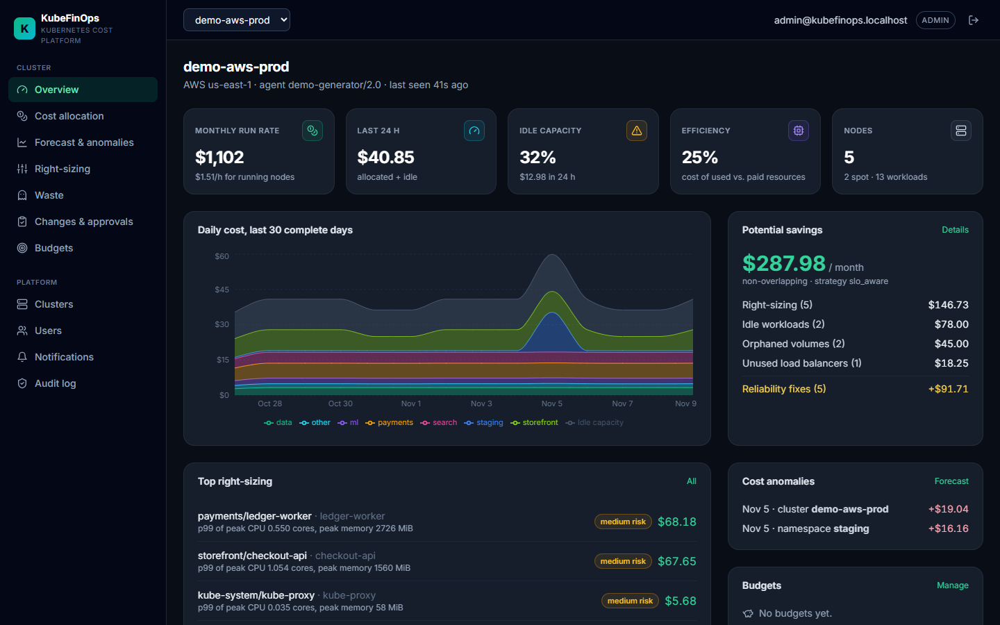
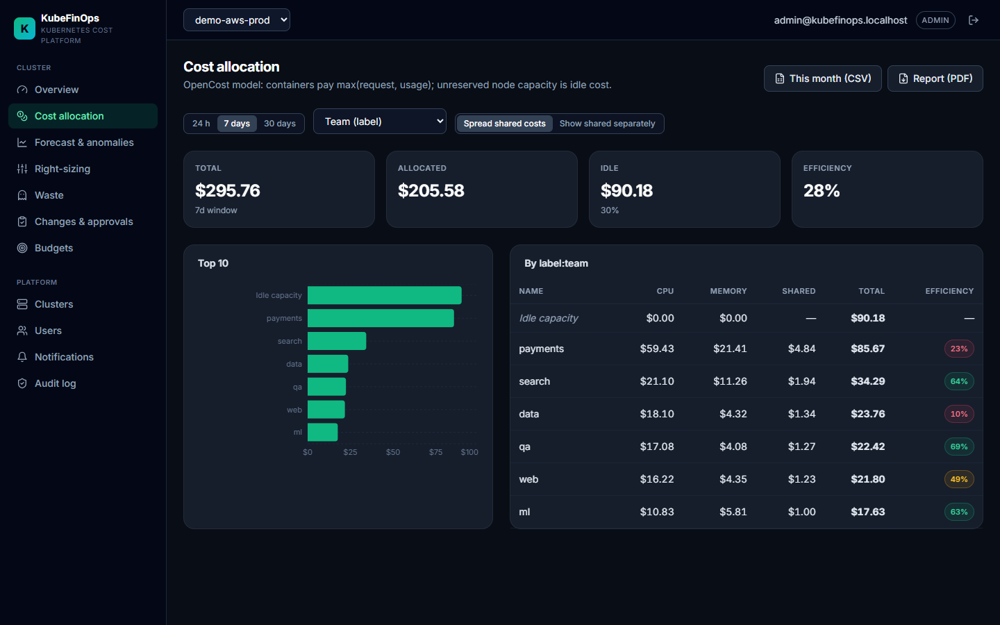
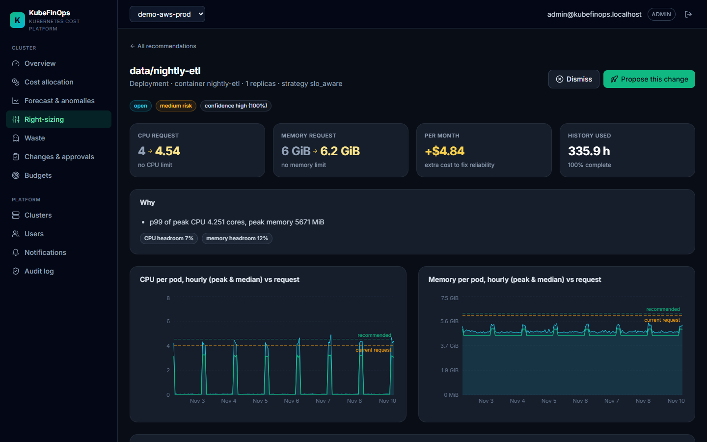
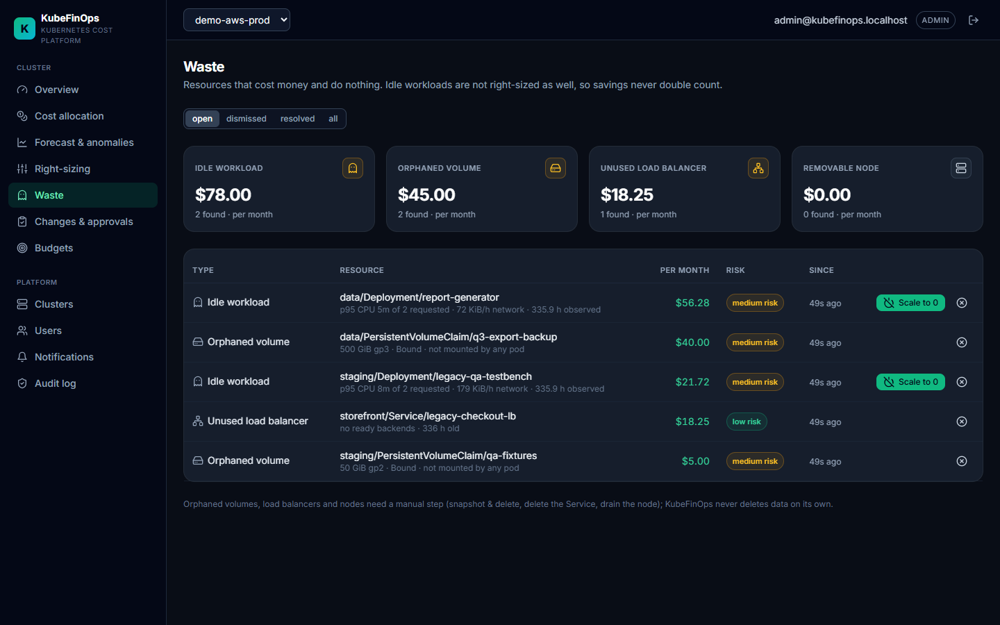
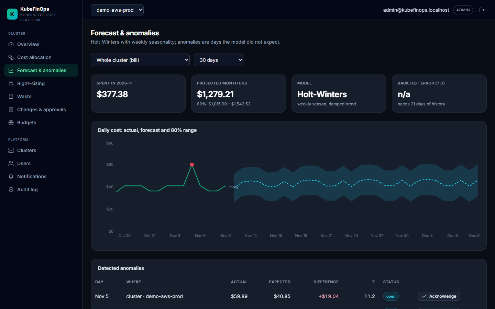
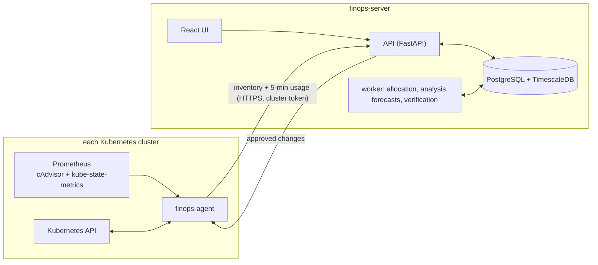

# KubeFinOps

**Open-source Kubernetes cost platform: see who spends what, find waste, and safely right-size workloads
across many clusters.**

[](https://github.com/vedant-0789/Kubernetes-FinOps-Cost-Optimization-Dashboard/actions/workflows/ci.yml)




Teams reserve far more CPU and memory than they use, and the bill is paid per node. KubeFinOps shows it:
* **Cost allocation**: who spends what, including idle and shared cost.
* **Waste detection**: idle workloads, orphaned volumes, unused load balancers, removable nodes.
* **Right-sizing** with a risk target, not a fixed buffer.
* **Safe changes**: server-side dry-run, two-person approval and automatic rollback.

The right-sizing method was evaluated on **2,037 production containers from Alibaba's cluster trace**. It
removed **64 %** of requested cost and was short of CPU **8–20× less often** than p95 and VPA-style baselines
([research](research/README.md)).

## Features

| | |
| :--- | :--- |
| **Multi-cluster** | A lightweight agent per cluster (read-only RBAC by default) pushes inventory and Prometheus usage to one server. |
| **Cost allocation** | OpenCost-compatible: node prices for AWS, GCP and Azure (regions, spot), on-prem prices by label; containers pay `max(request, usage)`; idle and shared cost; by namespace, workload, node, pod or any label. |
| **Showback / chargeback** | Monthly CSV and PDF reports that reconcile to the bill. |
| **SLO-aware right-sizing** | Picks the smallest request whose peak demand is exceeded in at most ε of the time. It accounts for CPU throttling, OOM kills, memory leaks and HPAs. Every recommendation shows evidence, confidence and risk. |
| **Waste detection** | Idle workloads, orphaned volumes, LoadBalancers without endpoints, consolidatable nodes. Savings never double count. |
| **Safe remediation** | Dry-run in the cluster, two-person approval, change windows, verification and automatic rollback on OOM kills, restarts or throttling. GitOps patch export. |
| **Forecasts and alerts** | Holt-Winters month-end forecast, cost anomaly detection, budgets per team, Slack, webhook and email notifications. |
| **Production-ready** | JWT users with viewer, operator and admin roles; hash-chained audit log; Helm charts with HPA, PDB and ServiceMonitor; non-root read-only containers; Prometheus metrics; JSON logs. |

<table>
<tr><td></td>
<td></td></tr>
<tr><td align="center">Cost allocation by team label, shared costs spread</td>
<td align="center">Right-sizing: hourly peaks vs current and recommended requests</td></tr>
<tr><td></td>
<td></td></tr>
<tr><td align="center">Waste: idle workloads, orphaned volumes, unused load balancers</td>
<td align="center">Forecast with 80 % band; a cost incident flagged as an anomaly</td></tr>
</table>

## Architecture



Details: [docs/architecture.md](docs/architecture.md). It covers the cost model, the right-sizing algorithm, the
remediation state machine, security and scaling.

## Quick start

**Local (2 minutes, synthetic demo cluster):**

```powershell
.\start.ps1                     # Windows; on Linux/macOS see docs/install.md
```

Open http://localhost:5173 and sign in as `admin@kubefinops.localhost`. The password is generated on first run
into `backend/.env`.

**Full stack in Docker:**

```bash
docker compose -f deploy/docker-compose.yml up --build      # UI :8080, API docs :8000/docs
```

**On a real Kubernetes cluster (local kind, with Prometheus, a real agent and demo workloads):**

```powershell
.\deploy\scripts\up.ps1         # or deploy/scripts/up.sh
```

**Production (EKS / GKE / AKS / on-prem):** install `deploy/helm/finops-server` once and
`deploy/helm/finops-agent` in each cluster. See [docs/install.md](docs/install.md).

## Research

`research/` contains the paper and the tooling behind it:
* a trace-replay simulator that runs the **same right-sizing code** the product uses;
* synthetic workload archetypes;
* a streaming loader for Alibaba cluster-trace-v2018;
* an IEEE-format paper draft whose tables and figures are generated from the experiments.

| Alibaba v2018, 2,037 containers | Savings | CPU under-provisioned windows | Containers with memory events |
| :--- | ---: | ---: | ---: |
| p95 + 20 % | 77.5 % | 3.20 % | 38 |
| VPA-style | 80.0 % | 7.92 % | 69 |
| **SLO-aware (ε = 1 %)** | **63.8 %** | **0.39 %** | **28** |

The realised under-provisioning stays below the chosen ε (0.5–5 %) on both synthetic and real traces.

## Documentation

| Document | For |
| :--- | :--- |
| [Installation & operations](docs/install.md) | Local dev, docker compose, kind, production Helm install, configuration, troubleshooting |
| [Architecture](docs/architecture.md) | Components, data flow, algorithms, security, scaling |
| [Demo script](docs/demo-script.md) | A 12-minute walkthrough and likely questions |
| [Project summary](docs/project-summary.md) | Key numbers, CV bullets, how to present it as a team |
| [Research](research/README.md) | Reproducing the experiments and building the paper |
| API reference | Interactive OpenAPI docs at `/docs` on any running server |

## Repository layout

```
backend/    FastAPI API + worker, engines (allocation, rightsizing, waste, forecast), migrations, tests
agent/      in-cluster agent: inventory, PromQL usage, remediation executor
frontend/   React UI
deploy/     docker-compose, Helm charts, kind environment, scripts
research/   simulator, Alibaba loader, experiments, paper
docs/       documentation and screenshots
```

## Development

```bash
cd backend  && pip install -r requirements-dev.txt && ruff check . && pytest      # 170 tests
cd agent    && pip install -r requirements.txt pytest ruff && pytest              # 46 tests
cd frontend && npm ci && npm test                                                  # 15 tests
cd research && pip install -r requirements.txt pytest && pytest                    # 18 tests
```

CI runs all of these on every pull request: backend on SQLite and TimescaleDB, Helm lint and render, and image
builds. Images are pushed to GHCR from `main` and from version tags.

## License

MIT. Started as a Cloud Computing course project and developed into a deployable platform.
