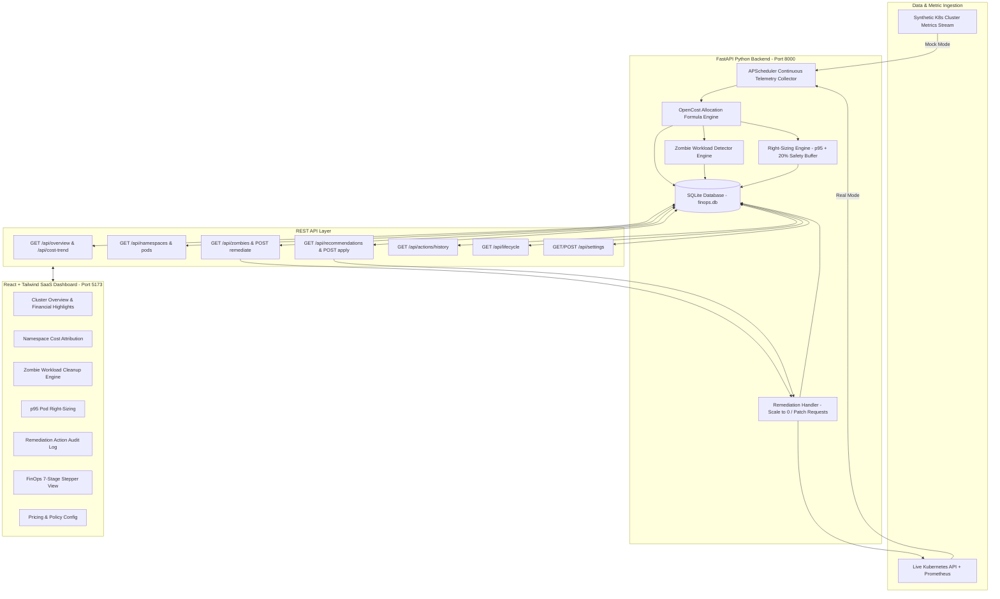

# Kubernetes FinOps & Cost-Optimization Dashboard

[](https://fastapi.tiangolo.com)
[](https://react.dev)
[](https://tailwindcss.com)
[](https://www.opencost.io)
[](https://kubernetes.io)

A full-stack, production-grade **Kubernetes FinOps & Cost-Optimization Dashboard** built to monitor cluster resource usage, estimate cloud costs per namespace and pod using OpenCost allocation models, automatically detect idle/"zombie" workloads, generate p95 right-sizing recommendations, and execute automated waste remediation.

Designed as a Cloud Computing course project demonstrating a closed-loop FinOps workflow: converting raw Kubernetes cAdvisor / Prometheus metrics into real financial visibility and automated waste elimination.

---

## 🏗️ System Architecture



---

## 🎯 Key Features

1. **Dual Execution Mode (Mock vs Live K8s Cluster)**:
   - **Mock Mode (Default)**: Out-of-the-box synthetic telemetry stream with 8 namespaces (`frontend-prod`, `backend-api`, `payments-service`, `ml-training-job`, `logging-stack`, `monitoring`, `analytics-worker`, `staging-zombies`), 22+ pods, and 30 days of pre-seeded trend data.
   - **Real Mode**: Connects directly to a live Kubernetes cluster using `kubectl` / `kubernetes` Python SDK and Prometheus queries.

2. **OpenCost Financial Cost Modeling**:
   - Calculates resource cost allocation using configurable hourly unit rates:
     $$\text{Hourly Cost} = \max(\text{CPU Req}, \text{CPU Usage}) \times \text{CPU Rate} + \max(\text{RAM Req GB}, \text{RAM Usage GB}) \times \text{RAM Rate}$$
     $$\text{Monthly Run Rate} = \text{Hourly Cost} \times 730\text{ hours}$$

3. **Zombie Workload Detection**:
   - Continuous background rule engine flagging workloads with sustained $\le 5\%$ CPU utilization and zero/low network IO for over 24 hours.
   - Dedicated Zombie Workloads page with one-click "Scale Deployment to 0 Replicas" remediation.

4. **Right-Sizing Recommendation Engine**:
   - Computes optimal CPU and RAM requests based on historical **p95 peak utilization + 20% safety margin**.
   - Calculates exact monthly financial savings ($/mo) per workload.
   - "Apply Recommendation" patches container resource requests via the K8s API or updates mock telemetry.

5. **Automated Remediation & Audit Log**:
   - Safety guardrail: Manual confirmation required by default (with toggle for Auto-Apply low-risk recommendations in Settings).
   - Permanent audit log tracking executed actions, timestamps, before/after metrics, and realized monthly savings.

6. **FinOps 7-Stage Lifecycle View**:
   - Visual stepper illustrating the 7 operational stages: **Observe → Measure → Attribute → Detect → Recommend → Optimize → Verify**.

---

## 🚧 v2 platform (in progress)

The project is being rebuilt into a deployable, multi-cluster FinOps platform
(TimescaleDB, in-cluster agent, Helm charts, SLO-aware right-sizing). Already in place:

- **API v1** under `/api/v1/*`, health probes `/healthz` & `/readyz`, Prometheus metrics at `/metrics`, request-ID tracing.
- **Database migrations** with Alembic (`backend/migrations`); PostgreSQL/TimescaleDB in production, SQLite for local dev.
- **Separate worker** process (`python -m app.worker`) so API replicas scale horizontally.
- **Containers**: `backend/Dockerfile` (non-root, healthcheck), `frontend/Dockerfile` (unprivileged nginx).
- **Tests & CI**: `pytest` suite run on SQLite and TimescaleDB, `ruff` lint, image builds to GHCR.

```bash
# Full stack in Docker (UI on :8080, API docs on :8000/docs)
docker compose -f deploy/docker-compose.yml up --build

# Backend tests
cd backend && pip install -r requirements-dev.txt && ruff check . && pytest
```

All settings are environment variables prefixed with `FINOPS_` (see `backend/app/core/config.py`).

## ⚡ Quick Start Guide

### Prerequisites
- Python 3.10+
- Node.js 18+
- npm or yarn

### Option 1: One-Click Startup (Windows)
Double-click `start.bat` or run in PowerShell:
```powershell
.\start.ps1
```

### Option 2: Manual Terminal Startup

#### 1. Launch FastAPI Backend
```bash
cd backend
python -m pip install -r requirements.txt
python run_backend.py
```
- **Backend API**: `http://127.0.0.1:8000`
- **Swagger Documentation**: `http://127.0.0.1:8000/docs`

#### 2. Launch React Frontend
Open a new terminal:
```bash
cd frontend
npm install
npm run dev
```
- **Frontend Dashboard**: `http://localhost:5173`

---

## 🔌 API Endpoints Reference

| Method | Endpoint | Description |
| :--- | :--- | :--- |
| `GET` | `/api/overview` | Cluster summary statistics & key metrics |
| `GET` | `/api/cost-trend?range=7d|30d` | Time-series cost data points |
| `GET` | `/api/namespaces` | List of namespaces with cost attribution & efficiency scores |
| `GET` | `/api/namespaces/{name}/pods` | Detailed pod metrics for a specific namespace |
| `GET` | `/api/zombies` | List of flagged idle/zombie workloads |
| `POST` | `/api/zombies/{id}/remediate` | Remediate zombie workload (scale deployment to 0 replicas) |
| `GET` | `/api/recommendations` | Active p95 right-sizing recommendations |
| `POST` | `/api/recommendations/{id}/apply` | Apply right-sizing patch to container requests |
| `GET` | `/api/actions/history` | Remediation audit trail & realized savings log |
| `GET` | `/api/lifecycle` | 7-stage FinOps lifecycle summary mapping |
| `GET/POST` | `/api/settings` | Read or update hourly cloud pricing & threshold policies |

---

## 🌐 Connecting to a Real Cluster

To switch from Mock Mode to a Live Kubernetes Cluster:
1. Ensure your local `~/.kube/config` file is configured for your cluster (e.g. Minikube, EKS, GKE, or Kind).
2. On the **Settings** page in the dashboard UI (or via `.env`), uncheck **Simulated Mock Data Mode**.
3. The backend will automatically initialize the official `kubernetes` Python client to query live pods and patch deployment specifications.

---

## 📜 License
Developed as an academic Cloud Computing FinOps course project. Open-source under the MIT License.
