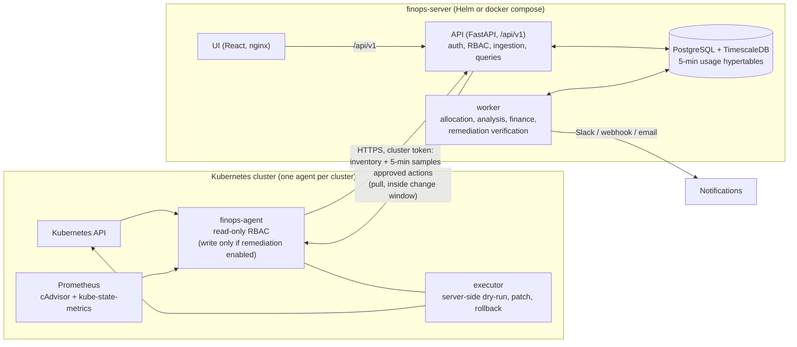
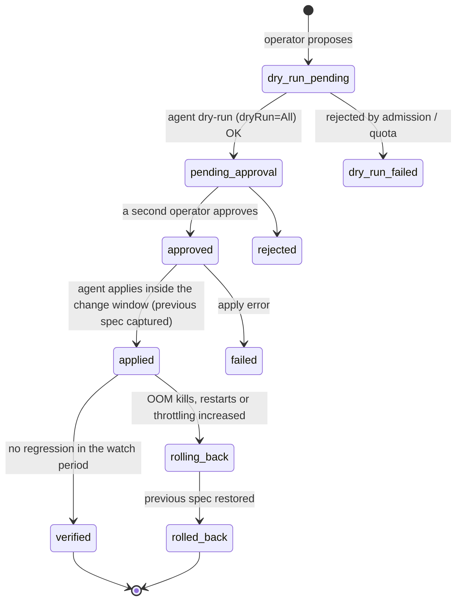

# Architecture

KubeFinOps is a multi-cluster Kubernetes cost platform. Each cluster runs a small, stateless **agent**. The
agent pushes inventory and usage to a central **server**: a FastAPI API, a background worker, PostgreSQL with
TimescaleDB, and a React UI. The server allocates cost, analyses waste and right-sizing, forecasts spend, and
sends approved changes back to the agent, which applies them safely.



The agent is pull-push: it only makes outbound calls, so the server never needs credentials for a cluster's API
server. Many clusters can report to one server, the same model Kubecost and CAST AI use.

## Components

| Component | Code | Runs as | Responsibility |
| :--- | :--- | :--- | :--- |
| Agent | `agent/finops_agent` | 1 Deployment per cluster | Every 5 min: inventory from the K8s API, usage from PromQL, push both to the server. Re-sends a back-fill window after a restart, and the server de-duplicates. Optional executor for approved changes. |
| API | `backend/app/main.py`, `routers/` | Deployment + HPA + PDB | Ingestion (cluster tokens), queries, users/JWT, remediation workflow, reports. Stateless, scales horizontally. |
| Worker | `backend/app/worker.py` | 1 Deployment | Periodic jobs: cost allocation (every 5 min, re-allocates the last 2 h for late samples), right-sizing and waste analysis, budgets/anomalies, remediation verification and rollback. Exposes its own `/metrics`. |
| Engines | `backend/app/engines/` | library | Pure functions with no DB access: `allocation`, `rightsizing`, `waste`, `forecast`. The same code runs in production and in the research simulator. |
| Database | Alembic `backend/migrations` | TimescaleDB (bundled StatefulSet or managed) | Hypertables with compression and retention for usage samples. SQLite is supported for local dev and tests. |
| UI | `frontend/src` | nginx (unprivileged) | Overview, allocation, forecast, right-sizing, waste, approvals, budgets, admin pages. |

## Data flow

1. **Inventory** (`POST /api/v1/ingest/inventory`): nodes (instance type, zone, capacity type spot/on-demand,
   capacity), workload owners with labels, PVCs and their mounts, LoadBalancer services and ready backends, HPAs.
2. **Samples** (`POST /api/v1/ingest/samples`): per container and 5-minute window, CPU mean and peak, memory
   working set mean and peak, CFS throttled share, network, restarts and OOM kills. Each batch also carries node
   heartbeats. Ingestion is idempotent per (container, window).
3. **Allocation** (worker): node hourly prices are split into per-core and per-GiB prices. Each container is
   charged `max(request, usage)`, unreserved capacity becomes *idle cost*, and system namespaces become
   *shared cost*. The result is hourly rows by namespace, workload, node, pod and label.
4. **Analysis** (worker): right-sizing recommendations and waste findings with evidence, confidence and risk.
   Savings are non-overlapping.
5. **Finance** (worker): Holt-Winters forecast, anomaly detection on forecast errors, budget alerts and showback
   reports.
6. **Remediation**: a proposed change goes through dry-run, two-person approval, the change window, apply, a
   watch period, and then verification or automatic rollback (see below).

## Cost allocation (OpenCost-compatible)

* **Node price**: taken from the agent (the `finops.io/hourly-price` label), per-cluster custom rates, or the
  catalogs in `backend/app/pricing/catalogs` (AWS, GCP, Azure). Catalogs include region multipliers and a spot
  discount. Storage classes and load balancers are priced from the same catalogs.
* **Split**: the price is split into CPU and RAM using OpenCost's default CPU:RAM cost ratio, so a node's cost
  equals `cores × price_per_core + GiB × price_per_GiB`.
* **Container cost** is `max(request, usage) × unit price` for CPU and memory. **Idle** is node capacity that no
  container reserved or used. Container cost plus idle always reconciles to the node bill, which a property test
  checks.
* **Node uptime** comes from heartbeats, so autoscaled and spot nodes only cost while they run.
* **Shared costs** (`kube-system`, `monitoring`, configurable) can be shown separately or spread over teams in
  proportion to their cost.

## SLO-aware right-sizing

`backend/app/engines/rightsizing.py`. The paper evaluates this method (see `research/`). Inputs are 5-minute
windows pooled across all replicas of a workload over 14 days.

* **CPU request**: the (1-ε) recency-weighted quantile of *peak* CPU (ε = 1 % by default), plus headroom from the
  coefficient of variation of complete days' daily peaks.
  * **Censoring correction**: if the container was throttled at its limit, observed usage understates demand, so
    the estimate is raised. It is anchored on the observed clipping level and capped at 2× per step.
  * **HPA-aware floor**: the request never drops below what keeps an HPA at its target utilisation.
* **Memory request**: peak working set plus volatility headroom. Each OOM kill counts as evidence that demand is
  at least the limit. Sustained growth (a leak) blocks reductions.
* **Safety**: reductions are capped at 50 % per step. Every recommendation has a confidence (history length ×
  completeness), a risk label and the evidence behind it.
* **Baselines** for comparison: VPA-style (p90 + 15 %, memory from one peak per 24 h, OOM bump ×1.2) and
  p95 + 20 %. The API runs all three side by side (`GET .../recommendations/{id}/compare`).

## Waste detection

`backend/app/engines/waste.py`:

* **Idle workloads**: owner-level CPU and network below thresholds over the window. An idle workload gets an idle
  finding *instead of* a right-sizing recommendation.
* **Orphaned volumes**: bound PVCs that no pod mounts.
* **Unused load balancers**: LoadBalancer Services with no ready backends.
* **Consolidatable nodes**: a best-fit simulation that never double-books free capacity. It overlaps with
  right-sizing, so it is reported separately.

Savings totals therefore never count the same dollar twice. Dismissed findings stay dismissed, and fixed
findings resolve automatically.

## Safe remediation



* **Guardrails**:
  * protected namespaces, and only Deployments and StatefulSets can be changed;
  * one open action per workload, a per-cluster hourly rate limit, and a change window (rollbacks bypass it);
  * a two-person rule: the proposer cannot approve their own change.
* **Executor**:
  * strategic-merge patches touch only the changed resources;
  * the previous spec is captured before applying, and a rollback restores it and removes limits the change
    added.
* **Verification**:
  * windows are aligned to sample-slot boundaries;
  * it waits for enough post-change data, then compares OOM kills, restarts and throttling against the period
    before the change.
* **GitOps**: every action can be exported as a kustomize strategic-merge patch (`.../actions/{id}/patch.yaml`)
  for teams that change clusters only through Git.

## Security

* **Users**: viewer, operator and admin roles. Passwords are PBKDF2-SHA256 with 600k iterations. JWTs are
  short-lived, and roles are re-read on every request so a demotion takes effect immediately.
* **Clusters**: one agent token per cluster, shown once. Only its SHA-256 hash is stored.
* **Agent RBAC**: read-only ClusterRole with no access to Secrets or ConfigMaps. Write verbs come only with
  `rbac.allowRemediation=true`.
* **Audit log**: every login, registry change, dismissal and remediation step is a hash-chained event (SHA-256 of
  the previous one). `GET /api/v1/audit/verify` finds edited or deleted events.
* **Containers**: non-root, read-only root filesystem, all capabilities dropped, seccomp `RuntimeDefault`.
* **Production config checks**: the API refuses to start in `prod` with auth on and no JWT secret. Webhook URLs
  are masked in API responses.

## Observability

* **Endpoints**: `/healthz` (liveness) and `/readyz` (checks the database).
* **Prometheus metrics**: `/metrics` on the API (request rate and latency by route template) and on the worker
  (job durations and failures). ServiceMonitors are included in both charts.
* **Logs**: structured JSON with a request ID propagated through the `X-Request-ID` header.

## Scaling notes

* **API**: stateless (JWT), with an HPA in the chart. Ingestion caps batch size
  (`FINOPS_MAX_SAMPLES_PER_REQUEST`).
* **Worker**: a single replica runs the periodic jobs. Migrations run once per release in an init container,
  serialised with a PostgreSQL advisory lock.
* **Storage**: usage samples live in a TimescaleDB hypertable with compression and retention. Analysis reads
  14 days of 5-minute data per workload.
* **Next step**: continuous aggregates (hourly and daily rollups) are the next step for clusters with tens of
  thousands of containers.

## Repository layout

```
backend/   FastAPI app, engines, services, Alembic migrations, pricing catalogs, tests
agent/     in-cluster agent (inventory, PromQL usage, executor), tests
frontend/  React UI, Vitest tests
deploy/    docker-compose, Helm charts (finops-server, finops-agent), kind environment, scripts
research/  replay simulator, workloads, Alibaba loader, experiments, IEEE paper
docs/      this documentation
```
